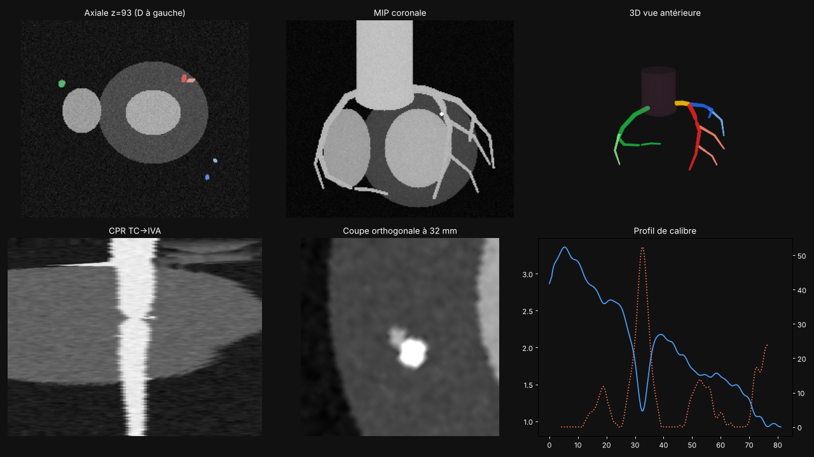

# CoroSeg — segmentation des coronaires sur coroscanner

Application locale (Python + Streamlit) qui, à partir d'un coroscanner injecté :

1. **segmente l'arbre coronaire** avec le modèle pré-entraîné *TotalSegmentator* (tâche `coronary_arteries`), ainsi que l'aorte ;
2. **identifie les vaisseaux** : tronc commun (TC), IVA, circonflexe (Cx), coronaire droite (CD), bissectrice éventuelle, et leurs branches ;
3. extrait les **lignes centrales** et produit des **CPR redressées**, des **coupes orthogonales** et un **profil de calibre** ;
4. affiche une **vue 3D** interactive et **exporte** les résultats (NIfTI, STL, lignes centrales CSV/JSON, rapport).

> ⚠️ **Outil de recherche / pédagogie, non marqué CE, non validé pour le diagnostic.** Le « rétrécissement relatif »
> est calculé sur le diamètre du masque segmenté : c'est un repère de lecture, pas une quantification de sténose.



---

## Installation

Prérequis : Python 3.10+, un GPU NVIDIA avec CUDA (fonctionne aussi sur CPU, mais compter plusieurs minutes par examen).

```bash
python -m venv .venv
source .venv/bin/activate            # Windows : .venv\Scripts\activate
# 1) PyTorch avec CUDA (choisir la commande adaptée sur https://pytorch.org/get-started/locally/), par ex. :
pip install torch --index-url https://download.pytorch.org/whl/cu124
# 2) le reste
pip install -r requirements.txt
```

### Licence TotalSegmentator (une seule fois)

La tâche `coronary_arteries` n'est pas en accès libre : une licence est requise, **gratuite pour un usage non commercial**
(demande en ligne : <https://backend.totalsegmentator.com/license-academic/>). Une fois reçue :

```bash
totalseg_set_license -l aca_XXXXXXXXXXXX
```

(ou la coller dans le champ « Licence » de l'interface). Les poids (~quelques centaines de Mo) sont téléchargés au premier lancement.

## Utilisation

### Interface

```bash
./lancer.sh          # Windows : lancer.bat   — ou : streamlit run app.py
```

Le navigateur s'ouvre sur `http://localhost:8501`. Tout reste sur la machine : aucune image n'est envoyée en ligne
(hormis le téléchargement initial des poids du modèle et le contrôle de licence de TotalSegmentator).

- **Examen** : chemin d'un dossier DICOM (toutes les séries sont listées : choisir la reconstruction de la meilleure phase,
  noyau mou, coupes fines), d'une archive `.zip` ou d'un `.nii.gz`. On peut aussi téléverser un fichier.
- **Démo (fantôme synthétique)** : vérifie toute la chaîne sans examen ni licence.
- **Masque existant** : si vous avez déjà une segmentation (autre logiciel, correction manuelle dans 3D Slicer…),
  chargez-la pour ne faire que l'étiquetage, les lignes centrales et les CPR.

Onglets : **Coupes** (axial/coronal/sagittal, fenêtrage, MIP, superposition des labels), **3D**, **CPR & calibre**
(rotation de la CPR, curseur le long du vaisseau, section orthogonale, profil Ø / rétrécissement), **Résumé & export**.

### En ligne de commande / par lot

```bash
python -m coroseg examen1/ examen2.zip examen3.nii.gz -o resultats/ --device gpu
python -m coroseg ct.nii.gz --masque coronaires.nii.gz --aorte aorte.nii.gz -o resultats/
python -m coroseg --demo -o resultats/
```

### Sorties

| Fichier | Contenu |
|---|---|
| `coronaires_labels.nii.gz` | carte de labels (1 TC, 2 IVA, 3 Cx, 4 CD, 5 branches IVA, 6 branches Cx, 7 branches CD, 8 bissectrice, 9 non attribué) |
| `coronaires_masque.nii.gz` | masque binaire de TotalSegmentator |
| `centerlines.csv` / `.json` | lignes centrales lissées (pas 0,5 mm), coordonnées en mm (repère RAS) et rayon local |
| `maillages/*.stl` | une surface par vaisseau + l'arbre complet (impression 3D, Slicer, Blender…) |
| `rapport.json` | volumes, longueurs, calibres, ostia, avertissements |

Les NIfTI sont réorientés en RAS ; ils se superposent directement au scanner dans 3D Slicer ou ITK-SNAP.

## Comment marche l'étiquetage

TotalSegmentator renvoie un **masque unique** « coronaires », sans distinguer les vaisseaux. CoroSeg ajoute :

1. **Ostia** : chaque composante connexe qui touche l'aorte (≤ 6 mm) est un arbre ; l'ostium est son point le plus proche de l'aorte.
   Gauche/droite selon la position de l'ostium par rapport au centre de la racine aortique.
2. **Squelette → arbre** : squelettisation 3D, puis arbre des plus courts chemins depuis l'ostium. Le tronc d'un arbre suit à chaque
   bifurcation la branche au plus gros sous-arbre (longueur × calibre²).
3. **Gauche** : le TC va jusqu'à la première bifurcation dont deux branches sont significatives ; la branche qui part vers l'avant
   est l'IVA, celle qui part vers l'arrière la Cx ; une troisième branche significative au même point = bissectrice.
4. **Branches** : toute branche latérale ≥ 10 mm prend l'étiquette « branche » de son tronc (diagonales/septales pour l'IVA,
   marginales pour la Cx, conus/VD/IVP pour la CD) et reçoit sa propre ligne centrale.
5. **Fragments** : les morceaux déconnectés (fréquents au niveau des calcifications ou des artéfacts de mouvement) sont
   rattachés au vaisseau le plus proche s'ils sont à moins de 15 mm, sinon marqués « non attribué ».

### Limites connues

- Les heuristiques supposent une anatomie usuelle : **ostia séparés IVA/Cx**, **naissance anormale**, **pontages** et
  **stents** peuvent être mal étiquetés (un avertissement s'affiche dans les cas détectables).
- Pas de distinction diagonales/septales, ni d'IVP/RVP par dominance : elles sont regroupées en « branches de ».
- Les segments très calcifiés ou flous sont souvent sous-segmentés, ce qui coupe l'arbre ; vérifier les fragments rattachés.
- Les calibres sont ceux du masque (discrétisation ~0,5–0,7 mm) : non fiables sous ~1,5 mm de diamètre.
- Pas encore de segmentation AHA/SCCT en 18 segments ni de score calcique.

## Tests

```bash
python -m pytest -q
```

Les tests s'exécutent sur un fantôme synthétique (TC, IVA avec sténose calcifiée, 2 branches IVA, Cx, 1 marginale, CD,
1 branche CD et un fragment distal déconnecté) et vérifient l'étiquetage, la détection du rétrécissement, les CPR,
les exports et la lecture DICOM.

## Structure

```
app.py                  interface Streamlit
coroseg/io.py           lecture DICOM / NIfTI, orientation RAS
coroseg/segment.py      appel à TotalSegmentator
coroseg/centerline.py   squelette, arbre, lignes centrales lissées
coroseg/labeling.py     identification TC / IVA / Cx / CD / branches
coroseg/cpr.py          CPR redressée, coupes orthogonales (repères à rotation minimale)
coroseg/mesh.py         surfaces et export STL
coroseg/pipeline.py     chaîne complète, mesures, exports
coroseg/phantom.py      fantôme synthétique (démo, tests)
```

Citer TotalSegmentator (Wasserthal et al., *Radiology: AI* 2023) et nnU-Net si vous publiez des résultats obtenus avec cet outil.
